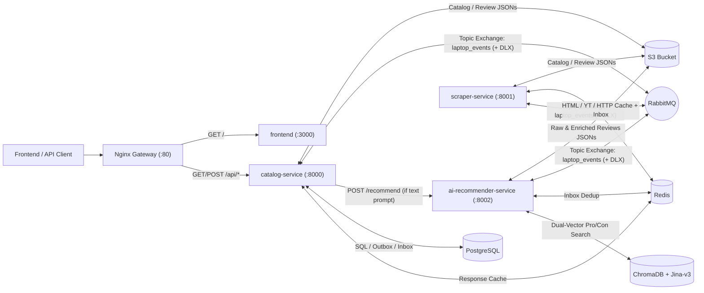
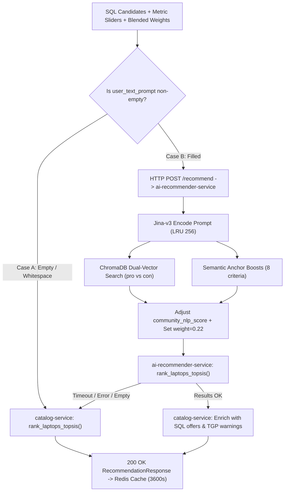
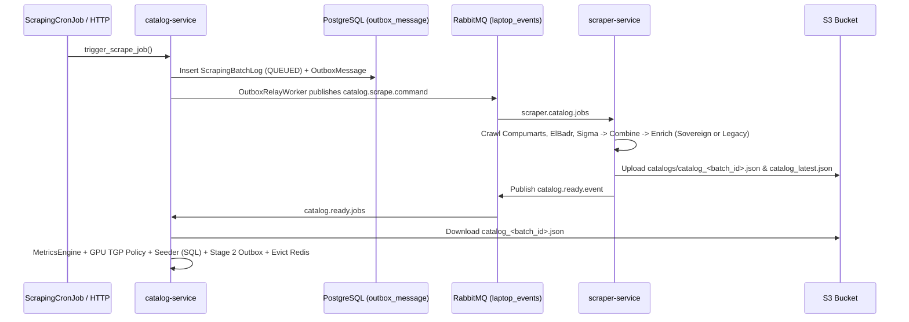
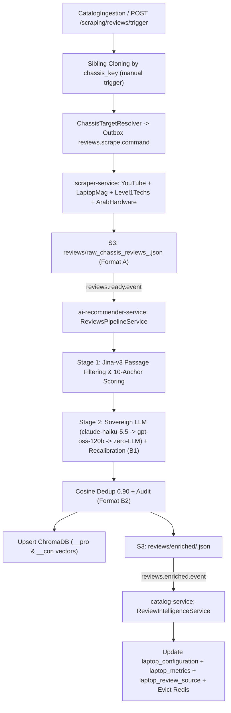

# End-to-End System Architecture & Data Flows

This document covers the complete, verified runtime flows across **`nginx`**, **`catalog-service`**, **`scraper-service`**, **`ai-recommender-service`**, **PostgreSQL**, **Redis**, **RabbitMQ**, **ChromaDB**, and **S3**.

---

## 1. System Topology

---

## 2. Recommendation Flow (`POST /api/v1/recommendations`)

### 2.1 Gateway, Middleware & Redis Cache Check

1. **Nginx (`nginx/conf.d/default.conf`)**:
   - Enforces `limit_req zone=api_limit burst=30 nodelay` (`20 req/s` per IP) on `/api/`.
   - Handles `OPTIONS` CORS preflight (`204`) and injects CORS headers for `localhost`, `127.0.0.1`, and `*.ngrok(-free).app`.
   - Proxies to `catalog-service:8000` (`proxy_connect_timeout 10s`, `proxy_read_timeout 60s`, `proxy_send_timeout 60s`).
2. **FastAPI Middleware Stack (`services/catalog-service/app/main.py`)**:
   - `CORSMiddleware` -> `CorrelationIdMiddleware` (`app/api/middlewares/correlation_id.py`, sets/propagates `X-Correlation-ID`) -> `ResponseCacheMiddleware` (`app/api/middlewares/response_cache.py`).
3. **Redis Response Cache (`ResponseCacheMiddleware`)**:
   - Enabled when `settings.enable_cache` is `True` (backed by `RedisCacheProvider` in `app/common/cache/redis.py`, failing open to `InMemoryCacheProvider` or bypassing on Redis errors).
   - Computes cache key:
     `catalog:recommendation:<sha256(f"{method}:{path}?{query}:".encode() + raw_body)>`
     *(Note: `/api/v1/recommendations/recommend` alias bypasses cache; `/api/v1/recommendations` is cached.)*
   - **Cache HIT**: Immediately returns cached JSON (`200 OK`) with `X-Cache: HIT`, `X-Cache-Key`, `X-Cache-Lookup-Time-Ms`.
   - **Cache MISS**: Proceeds to `generate_recommendations()` in `app/api/routes/recommendations.py` -> `RecommendationService.get_recommendations()` in `app/services/recommendation_service.py`.

---

### 2.2 SQL Retrieval, Dictionary Mapping & Pre-TOPSIS Filtering

Inside `RecommendationService.get_recommendations(request)` (`services/catalog-service/app/services/recommendation_service.py`):

1. **PostgreSQL Query (`LaptopRepository.get_candidates_for_recommendation`, `app/repositories/laptop_repository.py`)**:
   - Executes an async SQLAlchemy `select(LaptopConfiguration)` query with:
     - `selectinload(LaptopConfiguration.offers)` and `selectinload(LaptopConfiguration.metrics)` (batched eager loading, no N+1 queries).
     - `WHERE in_stock IS TRUE AND min_price_egp > 0`.
     - Optional `WHERE LOWER(brand) IN (...)` if `request.brand_filter` is provided.
     - `ORDER BY min_price_egp ASC`.
   - **Intentionally unbounded by budget in SQL** (`max_budget_egp=None`): so the domain engine still has fallback candidates if the user's budget or persona gates match zero laptops.
   - If `brand_filter` returns 0 rows, it retries without `brand_filter`.
   - If the database has 0 rows (e.g., offline test mode), falls back to `scraping input/unified_catalog_latest.json` (`_load_fallback_catalog()`).
2. **ORM -> Domain Dict (`to_recommender_dict`, `app/repositories/laptop_repository.py`)**:
   - Extracts 35+ hardware specs, 10 `topsis_inputs`, 5 `aspect_scores`, valid store offers (`is_valid_price == True`), `prices_by_store`, `urls_by_store`, `cheapest_offer_url`, and aligned `pros_en`/`pros_ar`/`cons_en`/`cons_ar`.
   - Dynamically runs `evaluate_gpu_tgp(...)` and `inject_gpu_tgp_warning(...)` (`app/domain/gpu_power_policy.py`) to prepend a bilingual TGP cap warning to `cons_en[0]`/`cons_ar[0]` for moderately/heavily capped GPUs and populate `native_base_max_tgp_w`, `native_max_tgp_w`, and `tgp_utilization_pct`.
3. **Optional Metric Slider Gates (`_passes_request_metric_filters`)**:
   - Filters `candidate_dicts` in memory against any optional request sliders:
     `min_acoustics_score`, `min_thermals_score`, `min_battery_score`, `min_build_score`, `min_keyboard_score`, `min_cpu_score`, `min_gpu_score`, `min_display_score`, `min_value_score`.
4. **Persona & Custom Weight Resolution**:
   - Resolves `primary_persona` (`request.persona` or `request.personas[0]`, defaulting to `balanced`).
   - If multiple `request.personas` are selected, averages `PERSONA_CONFIGS[p]["weights"]` across `TOPSIS_CRITERIA_KEYS`.
   - If `request.custom_weights` is provided, overrides those weights onto `blended_weights`.

---

### 2.3 The Two Cases of the Text Box (`user_text_prompt`)

#### Case A: Text Box is Empty (`user_text_prompt` is `None` or whitespace)
`ai-recommender-service` is **not called**. `catalog-service` executes its local domain engine `rank_laptops_topsis(...)` (`services/catalog-service/app/domain/recommender/topsis.py`):

1. **Weights**: Starts with `PERSONA_CONFIGS[p_key]["weights"]` (`community_nlp_score` default weight `0.06`), applies `blended_weights`, and normalizes weights to sum to `1.0`.
2. **Base Hard Filters (`base_pool`)**: Filters by `in_stock_active == True`, `effective_price_egp <= max_budget_egp` (and `>= min_budget_egp` if set), `brand_filter`, `min_ram_gb`, `min_storage_gb`, and `require_dgpu`.
3. **Implicit Persona Gates (`persona_pool`)**: Applies `PERSONA_CONFIGS[p_key]["implicit_gates"]` (`require_dgpu`, `min_refresh_hz`, `min_ram_gb`, `min_cpu_cores`, `require_creator_display`, `max_weight_kg`).
   - *Graceful relaxation*: If `< 3` candidates survive (when `len(base_pool) >= 3`) or `0` survive (when `len(base_pool) > 0`), relaxes back to `base_pool` and sets `gates_relaxed_for_low_budget = True`.
4. **Smart Budget Floor (`scoped_pool`)**: If `min_budget_egp` is not set and `len(persona_pool) > 5`, tries `60%` of `max_budget_egp` (requiring `>= 5` candidates), falling back to `45%` (requiring `>= 5` candidates), else keeping `persona_pool`.
5. **Zero-Candidate Fallback**: If `scoped_pool` is empty, selects up to `min(3, top_k)` cheapest in-stock laptops (preferring brand/persona/dGPU matches) with `status = "BUDGET_TOO_LOW_FOR_CATEGORY"`.
6. **10-Criteria TOPSIS Matrix (`run_topsis_vector`)**:
   - Evaluates `M x 10` matrix over `TOPSIS_CRITERIA_KEYS` (9 benefit criteria: `cpu_score`, `gpu_score`, `power_therm_score`, `display_score`, `mobility_score`, `longevity_score`, `ergonomics_score`, `connectivity_score`, `community_nlp_score`; 1 cost criterion: `effective_price_egp`).
   - Vector-normalizes columns, multiplies by weights, computes Ideal Best (`A+`) and Ideal Worst (`A-`), Euclidean distances `D+`/`D-`, and relative closeness `D- / (D+ + D-) * 100`.
7. **Response**: Sorts descending, slices `[:top_k]`, attaches bilingual `build_why_recommended` bullets (`app/domain/recommender/explainer.py`), and returns `RecommendationResponse`. `ResponseCacheMiddleware` caches the `200 OK` JSON in Redis (`TTL = 3600s`).

#### Case B: User Fills the Text Box (`user_text_prompt` is non-empty)
1. **HTTP Delegation (`HttpAIRecommenderClient.recommend`, `app/services/ai_recommender_client.py`)**:
   - `catalog-service` sends `POST {ai_recommender_url}/recommend` with `X-API-Key` header and `10.0s` timeout.
   - Payload includes `max_budget_egp`, `min_budget_egp`, `persona`, `user_text_prompt`, `min_ram_gb`, `min_storage_gb`, `require_dgpu`, `brand_filter`, `custom_weights=blended_weights`, `top_k`, `include_workloads=False`, and `candidate_laptops=candidate_dicts` (all active SQL candidates that passed metric sliders).
2. **Inside `ai-recommender-service` (`app/api/routes.py` -> `LaptopRecommenderService.recommend` in `app/services/recommendation_service.py`)**:
   - `APIKeyAuthMiddleware` verifies `X-API-Key`. Execution runs in `asyncio.to_thread(...)`.
   - **Dual-Vector ChromaDB & Semantic Anchor Boosts** (`_compute_dual_review_and_semantic_boosts`, wrapped in `lru_cache(maxsize=256)` keyed by stripped `user_text_prompt`):
     1. Encodes `user_text_prompt` once with `JinaV3EmbeddingFunction` (`jinaai/jina-embeddings-v3`, `task="retrieval.query"`, `truncate_dim=512`, `max_seq_length=256`) -> `q_vec`.
     2. `ChromaDualVectorQuery.query(q_vec_list, n_results=189)` (`app/infrastructure/chroma_repository.py`) runs two cosine queries against Chroma collection `laptop_chassis_reviews_jina_v3`: one with `where={"polarity": "pro"}` and one with `where={"polarity": "con"}`.
     3. `score_dual_review_vectors(pro_res, con_res)` (`app/domain/recommendation/topsis.py`) converts distance to similarity `max(0, 1 - dist)`, computes `net_sim = pro_sim - 0.75 * con_sim`, and adjusts `community_nlp_score = clamp(base_score + net_sim * 32.0, 35.0, 98.0)` across matched `canonical_id`s.
     4. `compute_semantic_weight_boosts(anchor_keys, anchor_matrix, q_vec)` computes dot products between `q_vec` and 8 pre-embedded `CRITERIA_SEMANTIC_ANCHORS`; any criterion with `sim >= 0.48` receives weight boost `round((sim - 0.45) * 0.35, 3)`.
   - **Score & Weight Injection**:
     - Overrides `community_nlp_score` in `working_laptops` using `adj_map`.
     - Adds `semantic_boosts` onto `merged_custom_weights` and sets `merged_custom_weights["community_nlp_score"] = 0.22` (unless explicitly overridden by `custom_weights`).
   - **TOPSIS Ranking (`ai-recommender-service/app/domain/recommendation/topsis.py:rank_laptops_topsis`)**:
     - Runs `parse_user_text_prompt(user_text_prompt)` for bilingual keyword constraint extraction (`min_ram_gb`, `min_storage_gb`, `require_oled`, `require_touchscreen`, keyword `weight_boosts`).
     - Merges `PERSONA_CONFIGS` -> `merged_custom_weights` -> `w_boosts`, normalizes weights, runs hard filters, persona `implicit_gates`, 60%/45% floor, and 10-column `_run_topsis_vector`.
     - Attaches `community_reviews`, skips `evaluate_workloads` (`include_workloads=False`), and returns JSON.
3. **Mapping Back & Graceful Fallback in `catalog-service`**:
   - If `remote_payload` contains non-empty `results`: `_map_ai_response_to_recommendation_response(...)` enriches each result with authoritative SQL metadata (`offers`, `urls_by_store`, `cheapest_offer_url`, `aspect_scores`, `pros_*`, `cons_*`, `reviews_evidence_count`) and runs `evaluate_gpu_tgp` + `inject_gpu_tgp_warning`.
   - **Fallback**: If `ai-recommender-service` is unreachable, times out (`> 10s`), returns an HTTP error, or returns empty `results`, `catalog-service` falls back seamlessly to its own local `rank_laptops_topsis(..., user_text_prompt=request.user_text_prompt)` (using local regex/keyword prompt parsing + local zero-candidate fallback).
   - `ResponseCacheMiddleware` caches the final `200 OK` JSON in Redis (`TTL = 3600s`).

---

## 3. Catalog Browse, Detail & Price History Read Flows

All endpoints in `services/catalog-service/app/api/routes/catalog.py` are cached in Redis (`TTL = 3600s`) by `ResponseCacheMiddleware`:

- **`GET /api/v1/laptops`** (alias `/api/v1/catalog/laptops`) -> `CatalogQueryService.list_laptops` -> `LaptopRepository.list_and_count_configurations`:
  - Supports `search` (`ILIKE` on title, model, family, brand, MPN, CPU, GPU), `min_price`, `max_price`, `brand`, `in_stock_only`, 9 `min_*_score` metric filters, and deterministic keyset cursor pagination (`app/common/cursor.py`) ordered by `(min_price_egp, id)`. Cache namespace: `catalog:browse:<sha256>`.
- **`GET /api/v1/laptops/{laptop_id}`** (alias `/api/v1/catalog/laptops/{laptop_id}`) -> `CatalogQueryService.get_laptop_detail` -> `LaptopRepository.get_by_identifier`:
  - Looks up by UUID, `canonical_id`, or `mpn` (eagerly loading `offers`, `metrics`, `review_sources`), enriches `GpuSpecDetail` with `native_base_max_tgp_w`/`native_max_tgp_w`/`tgp_utilization_pct`, and dynamically injects GPU TGP warnings into `cons_en`/`cons_ar`. Cache namespace: `catalog:laptop:<sha256>`.
- **`GET /api/v1/laptops/{laptop_id}/price-history`** -> `CatalogQueryService.get_laptop_price_history` -> `PriceHistoryRepository.get_by_laptop_id` -> `PriceHistoryDomainService.build_laptop_price_history`:
  - Reads `offer_price_history` and constructs piecewise-constant step curves with synthetic live edges. Cache namespace: `catalog:price_history:<sha256>`.

---

## 4. Stage 1: Laptop Scraping, Enrichment & Catalog Ingestion

### 4.1 Trigger & Transactional Outbox (`catalog-service`)
1. **Trigger**: Either `ScrapingCronJob.run_once` (`scripts/run_scraping_cron.py`) or `POST /api/v1/scraping/trigger` (`app/api/routes/scraping.py`) calls `ScraperClientService.trigger_scrape_job` (`app/services/scraper_client.py`).
2. **Watermarks & Staging**: Reads active watermarks from `store_scraping_pointer` (`StoreScrapingPointerRepository.list_active`), inserts `ScrapingBatchLog` (`status="QUEUED"`), and inserts `OutboxMessage` (`event_type="catalog.scrape.command"`, `routing_key="catalog.scrape.command"`, `status="PENDING"`).
3. **Outbox Relay (`OutboxRelayWorker`, `app/jobs/outbox_relay.py`)**: Polls `outbox_message` every `2.0s` using `SELECT ... FOR UPDATE SKIP LOCKED`, publishes to RabbitMQ exchange `laptop_events`, and marks `PUBLISHED`.

### 4.2 Scraping & Extraction Pipeline (`scraper-service`)
`ScraperMessageConsumer.handle_catalog_scrape_command` (`services/scraper-service/app/services/messaging_consumer.py`) deduplicates via Redis `inbox:<event_id>` and invokes `ScrapeOrchestrator.execute` (`app/services/orchestrator.py`):

1. **Level-2 Store Crawling**: Runs `CompumartsStoreScraper`, `ElBadrStoreScraper`, and `SigmaComputerStoreScraper` (`app/stores/`). Filters non-laptops/used items via Gate 1 (`should_skip_card`) and Gate 2 (`should_skip_pdp`), stopping when hitting the `until_model` watermark (unless `force_full_crawl=True`).
2. **Pre-Combiner Extraction (Layers 2–5, zero ONNX)** (`GenericCatalogPipeline.process_catalog` -> `LaptopExtractionPipeline.process_raw_product`):
   - Gate 3 (`ProductClassifier.is_valid_new_laptop`) -> Layer 2 (`TextSanitizer`) -> Layer 3 (`CPUAnchorExtractor`) -> Layer 4 (`DeterministicExtractor` across 12 spec categories) -> Layer 5 (`PhysicalValidator`).
3. **Cross-Store Deduplication (`CatalogCombiner.combine_catalogs`, `app/matching/combiner.py`)**:
   - Deduplicates listings across stores using MPN + hardware DNA fingerprint inverted indexes and Union-Find (`DisjointSet`) with `are_hardware_compatible` guards, producing `CanonicalLaptop` entries with price rollups and sorted `offers`.
4. **Post-Combiner Enrichment Routing (`should_use_sovereign_pipeline`)**:
   - **Pipeline B (Sovereign)** (`app/pipeline/sovereign_pipeline.py`): Used when `combined_unique_count <= LLM_FULL_EXTRACT_BATCH_THRESHOLD` and API key is configured. Performs read-only Icecat lookup + micro-batched LLM extraction via `SovereignEGClient` (with SHA-256 cache `sovereign_extract_cache.json`) + `validate_and_normalize_extracted_specs`.
   - **Pipeline A (Legacy)**: Runs Layer 6 ONNX fallback (`NuExtractFallbackExtractor` / `GLiNERONNXFallbackExtractor`) + Layer 7 `PhysicalValidator` + `DeadLetterQuarantine` + `BatchCircuitBreaker`, re-runs `CatalogCombiner`, then runs Stage 3/4 `IcecatCatalogEnricher` + optional `LLMAuditor` / `WebSpecSearchService`.
5. **Artifact Upload & Event**: Saves `unified_catalog_latest.json` locally and uploads `stores/store_<key>.json`, `catalogs/catalog_<batch_id>.json`, and `catalogs/catalog_latest.json` to S3, then publishes `catalog.ready.event` (`CatalogReadyEvent`) or `catalog.scrape.failed`.

### 4.3 Metrics Calculation & PostgreSQL Seeding (`catalog-service`)
`CatalogMessageConsumer.handle_catalog_ready_event` claims `event_id` in PostgreSQL `inbox_message` (`InboxRepository.claim_message`) and calls `CatalogIngestionService.ingest_from_s3`:

1. **Metrics Enrichment (`CatalogMetricsService` -> `compute_laptop_metrics` in `app/services/metrics_engine.py`)**:
   - Verifies `cpu.model`, `gpu.model`, `memory.capacity_gb`, `storage.capacity_gb`.
   - Calculates 10 `topsis_inputs` scores (`cpu_score`, `gpu_score`, `power_therm_score`, `display_score`, `mobility_score`, `longevity_score`, `ergonomics_score`, `connectivity_score`, `community_nlp_score` defaulting to `75.0`, `value_score`), `silicon_index`, and operational tiers (including `evaluate_gpu_tgp` from `app/domain/gpu_power_policy.py`).
2. **PostgreSQL Seeding (`CatalogSeederRepository.upsert_catalog`, `app/repositories/seeder.py`)**:
   - Matches existing laptops in chunks of 500 by `canonical_id` or `(upper(mpn), ram_capacity_gb, storage_capacity_gb)`.
   - Upserts **`laptop_configuration`**, **`laptop_offer`**, **`laptop_metrics`**, optional **`laptop_review_source`**, and appends **`offer_price_history`** rows for new offers or price/stock changes (`abs(delta) >= 1.0` or stock flip).
3. **Stage 2 Review Dispatch, Watermarks & Cache Eviction**:
   - Calls `_dispatch_review_scrape_command` to queue `reviews.scrape.command` for unreviewed laptops (7-day cooldown).
   - Updates **`store_scraping_pointer`** (up to 10 latest SKU/MPN pointers per store) and **`scraping_batch_log`** (`status="SUCCESS"`).
   - Post-commit: clears Redis prefixes `catalog:browse`, `catalog:laptop`, `catalog:recommendation`, `catalog:price_history`.

---

## 5. Stage 2: Reviews Scraping, Synthesis, ChromaDB & SQL Ingestion

### 5.1 Queuing & Chassis Collapse (`catalog-service`)
1. **Trigger**: Automatically after `CatalogIngestionService` finishes, or manually via `POST /api/v1/scraping/reviews/trigger` (`ReviewIntelligenceService.dispatch_review_scraping`).
2. **Eligibility & 7-Day Cooldown**: `LaptopRepository.get_unreviewed_laptops(retry_cooldown_days=7)` selects laptops with `has_reviews IS FALSE` and (`reviews_checked_at IS NULL` or `<= now - 7 days`).
3. **Reviewed-Sibling Cloning** (in `ReviewIntelligenceService.dispatch_review_scraping` when `not force_all`):
   - Extracts `chassis_key` via `ChassisKeyExtractor.extract()`, finds already-reviewed donors sharing that `chassis_key`, and clones their `pros_*`, `cons_*`, `aspect_scores`, `community_nlp_score`, and `review_sources` directly without re-scraping.
4. **Chassis Collapse & Outbox**: `ChassisTargetResolver.resolve()` collapses remaining variants into one `LaptopReviewTarget` per physical chassis and inserts `OutboxMessage` (`reviews.scrape.command`).

### 5.2 Multi-Platform Review Collection (`scraper-service`)
`ScraperMessageConsumer.handle_reviews_scrape_command` invokes `ReviewCollectorService.process_reviews_batch` (`services/scraper-service/app/services/reviews/collector.py`):

1. **YouTube (`YouTubeReviewsCollector`, concurrency `2`)**:
   - Builds bilingual queries (`"{en_subject} review"` and `"مراجعة {ar_subject}"`), runs cookieless `yt-dlp` flat search (skips Shorts `< 90s`, max `3` results), filters relevance via `matches_target_text`, fetches transcripts (`youtube-transcript-api` -> `yt-dlp` subtitles fallback) and top 10 comments. Cached in Redis (`reviews:yt:video:{video_id}`, 14-day TTL).
2. **Communities & Editorial (`CommunitiesReviewsCollector`, concurrency `5`)**:
   - Runs `LaptopMagPlatformScraper`, `Level1TechsPlatformScraper` (OP-only Discourse posts `>= 40` chars), and `ArabhardwarePlatformScraper` (`/reviews/` articles). Cached in Redis (`reviews:http:*`, 7-day TTL).
3. **Output**: Writes local Format A JSON (`scraping results/reviews/raw_chassis_reviews_{job_id}.json`), uploads to S3 (`reviews/raw_chassis_reviews_{job_id}.json`), and publishes `reviews.ready.event` (or `reviews.failed`).

### 5.3 Enrichment, Deduplication & ChromaDB Upsert (`ai-recommender-service`)
Triggered either asynchronously via RabbitMQ `ai.reviews.ready.jobs` (`ReviewsPipelineService.process_reviews_ready`) or synchronously via `POST /ingest-reviews` (`_run_ingest_sync` in `app/api/routes.py`):

1. **Stage 1 — Local Jina-v3 Passage Filtering (`JinaPassageScorer`, `app/infrastructure/jina_embedder.py`)**:
   - Gathers chunks from transcripts, comments, editorial reviews, and community posts; lexically selects up to 24 candidates; embeds with `jinaai/jina-embeddings-v3` (`task="retrieval.passage"`, `truncate_dim=512`); scores against 10 aspect anchors (`_PRO_ANCHORS`/`_CON_ANCHORS`) + `_NOISE_ANCHOR`; cosine-dedups (`0.88`) down to 16 snippets.
2. **Stage 2 — LLM Synthesis & Recalibration (`ReviewsEnrichmentService`, `ThreadPoolExecutor(max_workers=8)`)**:
   - Calls `SovereignEGClient` `/chat/completions`: tries `claude-haiku-5.5`, falls back to `gpt-oss-120b`, and falls back to `enrich_chassis_zero_llm()` if both fail.
   - Validates 5 aspect scores `[35.0, 98.0]` and bilingual `pros_*`/`cons_*` (2–6 items each).
   - Applies `_recalibrate_item()` (1.25x contrast stretch, chassis material & battery anchoring, weighted `community_nlp_score`) -> **Format B1**.
3. **Deduplication & Audit (`ReviewsAuditService` -> `audit_and_deduplicate_payload`)**:
   - Deduplicates raw + synthesized chunks via sparse n-gram cosine (`threshold=0.90`), extracts compact `review_sources`, and emits **Format B2** (`chassis_reviews[]`).
4. **ChromaDB Dual-Vector Upsert (`ChromaReviewsRepository`, collection `laptop_chassis_reviews_jina_v3`)**:
   - Upserts 2 documents per `chassis_key` (in batches of 16):
     - `{chassis_key}__pro` (`polarity: "pro"`)
     - `{chassis_key}__con` (`polarity: "con"`)
5. **Reload & Notify**: Uploads Format B2 to S3 (`reviews/enriched/{job_id}.json`), calls `RecommendationService.refresh_reviews_state()` (clears `_cached_dual_query` LRU cache and reloads Chroma collection), and publishes `reviews.enriched.event` (or `reviews.enrich.failed`).

### 5.4 PostgreSQL Review Persistence (`catalog-service`)
`CatalogMessageConsumer.handle_reviews_enriched_event` calls `ReviewIntelligenceService.ingest_from_s3`:
- Updates **`laptop_configuration`** (`pros_en`, `pros_ar`, `cons_en`, `cons_ar`, `reviews_evidence_count`, `has_reviews`, `reviews_checked_at`).
- Updates **`laptop_metrics`** (`community_nlp_score`, `thermals_score`, `acoustics_score`, `build_and_hinges_score`, `keyboard_and_trackpad_score`, `real_battery_and_reliability_score`).
- Replaces **`laptop_review_source`** rows per laptop.
- Evicts Redis prefixes `catalog:browse`, `catalog:laptop`, and `catalog:recommendation`.

---

## 6. Price & Availability Tracking Pipeline

1. **Dispatch (`catalog-service`)**:
   - `PriceSyncCronJob.dispatch_once` (`scripts/run_price_sync_cron.py`) calls `PriceSyncService.build_price_check_batches`.
   - `OfferRepository.get_stale_offers` queries `laptop_offer` where `is_valid_price = True`, ordered by `last_checked_at ASC NULLS FIRST`, partitioned by `store_key` into `PriceCheckBatchRequest` batches.
   - Inserts one `outbox_message` per store batch (`routing_key="prices.check.command"`). `OutboxRelayWorker` publishes to RabbitMQ.
2. **Live Check (`scraper-service`)**:
   - `ScraperMessageConsumer.handle_check_prices_command` runs `PriceMonitorService.check_batch_async` (`app/price_monitor/service.py`) using `curl_cffi.requests.AsyncSession(impersonate="chrome120")` (`Semaphore(5)`, `0.2s` delay).
   - Store extractors (`CompumartsPriceExtractor`, `ElBadrPriceExtractor`, `SigmaPriceExtractor`, `GenericPriceExtractor` in `app/price_monitor/extractors.py`) classify each offer (`abs(delta) >= 1.0` EGP) into `UNCHANGED`, `PRICE_DROP`, `PRICE_HIKE`, `OUT_OF_STOCK` (including `404`/`410`), `RESTOCKED`, or `ERROR`.
   - Publishes `prices.checked.event` (`PricesCheckedEvent`).
3. **Apply Diffs & Recalibrate (`catalog-service`)**:
   - `CatalogMessageConsumer.handle_prices_checked_event` calls `PriceSyncService.apply_batch_results`:
     - **Changed offers**: `PricingDomainService.evaluate_offer_transition` updates `laptop_offer` and appends a row to **`offer_price_history`**.
     - **Unchanged offers**: Bulk-touches `last_checked_at` via `OfferRepository.bulk_touch_watermarks`.
     - **Affected laptops**: `PricingDomainService.calculate_laptop_rollup` (filtering `is_valid_price` and `price_egp >= 5000.0`, prioritizing in-stock) updates **`laptop_configuration`**, and `PricingDomainService.recalculate_value_score` updates `effective_price_egp`, `in_stock_active`, and `value_score` in **`laptop_metrics`**.
     - Logs **`scraping_batch_log`** (`trigger_type="PRICE_MONITOR"`) and evicts Redis caches (`catalog:price_history`, `catalog:laptop`, `catalog:browse`, `catalog:recommendation`).

---

## 7. Infrastructure Quick Reference

### RabbitMQ (`laptop_events` Topic Exchange + `laptop_events.dlx`)
| Consumer | Queue | Routing Key | Handler |
|---|---|---|---|
| `scraper-service` | `scraper.catalog.jobs` | `catalog.scrape.command` | `handle_catalog_scrape_command` |
| `scraper-service` | `scraper.price.jobs` | `prices.check.command` | `handle_check_prices_command` |
| `scraper-service` | `scraper.reviews.jobs` | `reviews.scrape.command` | `handle_reviews_scrape_command` |
| `ai-recommender-service` | `ai.reviews.ready.jobs` | `reviews.ready.event` | `handle_reviews_ready_event` |
| `catalog-service` | `catalog.ready.jobs` | `catalog.ready.event` | `handle_catalog_ready_event` |
| `catalog-service` | `catalog.scrape.failed.jobs` | `catalog.scrape.failed` | `handle_catalog_scrape_failed` |
| `catalog-service` | `catalog.prices.checked.jobs` | `prices.checked.event` | `handle_prices_checked_event` |
| `catalog-service` | `catalog.reviews.enriched.jobs` | `reviews.enriched.event` | `handle_reviews_enriched_event` |
| `catalog-service` | `catalog.reviews.failed.jobs` | `reviews.failed` | `handle_reviews_failed` |
| `catalog-service` | `catalog.reviews.enrich.failed.jobs` | `reviews.enrich.failed` | `handle_reviews_enrich_failed` |

### PostgreSQL Tables (`catalog-service`)
- `laptop_configuration` (`app/models/laptop.py`)
- `laptop_offer` (`app/models/offer.py`)
- `offer_price_history` (`app/models/offer.py`)
- `laptop_metrics` (`app/models/metrics.py`)
- `laptop_review_source` (`app/models/review_source.py`)
- `store_scraping_pointer` (`app/models/scraping.py`)
- `scraping_batch_log` (`app/models/scraping.py`)
- `outbox_message` (`app/models/outbox.py`)
- `inbox_message` (`app/models/inbox.py`)
